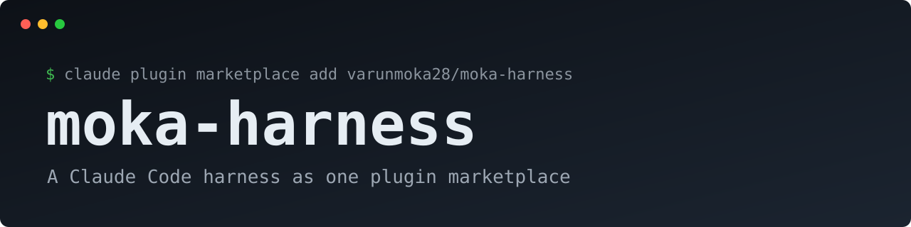
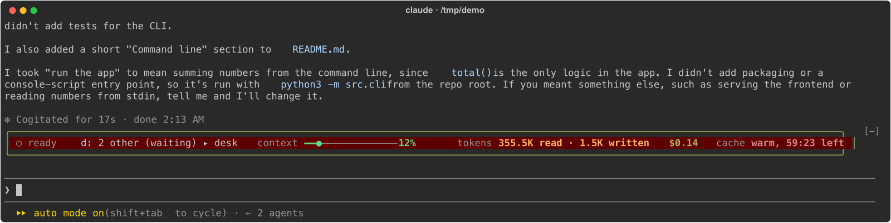
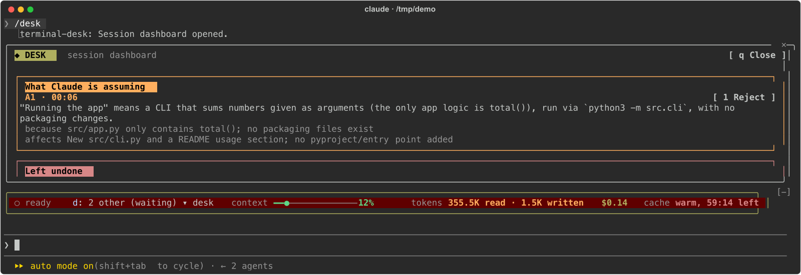
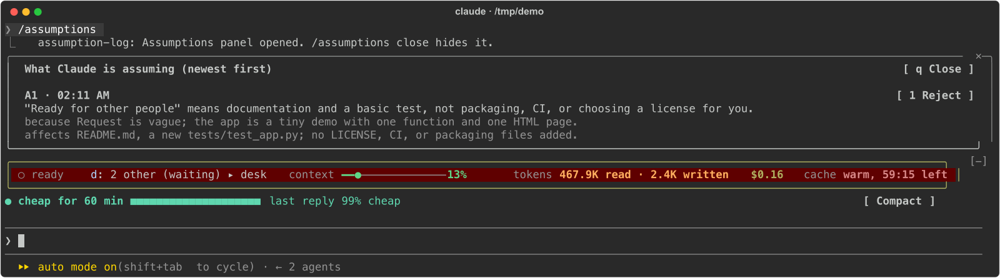
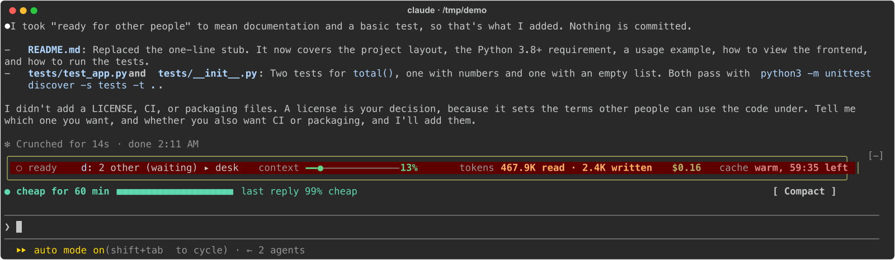
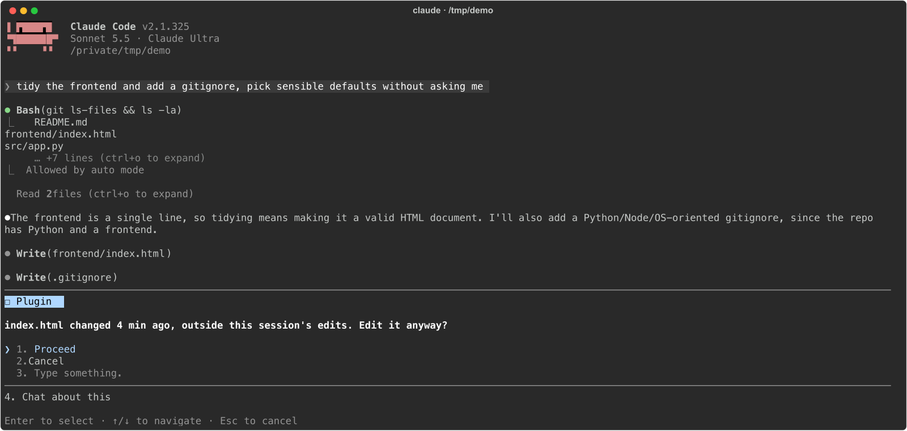
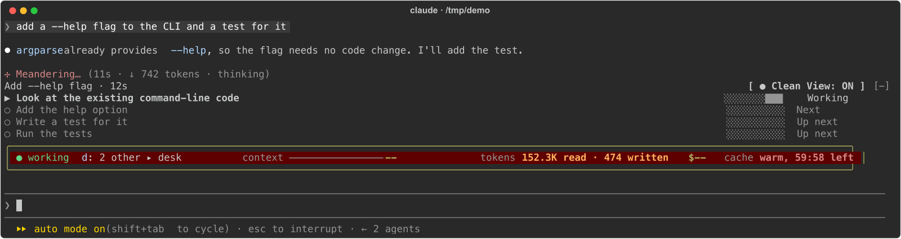

<h1 align="center"></h1>

<div align="center">

[](https://github.com/varunmoka28/moka-harness/actions/workflows/checks.yml)
[](https://github.com/varunmoka28/moka-harness/actions/workflows/pin-check.yml)
[](#licence)


</div>

A Claude Code harness as one plugin marketplace: guard hooks, terminal mods, working-style rules, and third-party plugins and skills pinned to one commit each.

```
claude plugin marketplace add varunmoka28/moka-harness
claude plugin install core@moka-harness
```

Run these in a shell. Inside a Claude Code session, `/plugin` only opens a panel; it does not install. Then run `/core:doctor` in a session: it reports which outside tools and keys the groups you installed still need. It only reads; it installs nothing.

`core` is the working-style file, three guard hooks and a `doctor` skill. Its needs are listed under [Prerequisites](#prerequisites). The full catalogue, searchable, is at https://varunmoka28.github.io/moka-harness/.

[What it is](#what-it-is) · [Prerequisites](#prerequisites) · [Basic workflow](#basic-workflow) · [How far to trust this](#how-far-to-trust-this) · [Own plugins](#own-plugins-a-sample) · [Groups](#groups) · [Everything in it](#everything-in-it) · [When something goes wrong](#when-something-goes-wrong) · [What it does not do](#what-it-does-not-do) · [Remove it](#remove-it) · [Contributing](#contributing) · [Credits](#credits)

## What it is

moka-harness is a Claude Code harness in three parts:

- **Own plugins.** Small mods for the Claude Code terminal, guard hooks that stop a bad delete or a careless edit, and a short working-style file.
- **Adapted plugins.** Six plugins built on other people's mods. The original authors are named in [Credits](#credits) and in each plugin's `LICENSE`.
- **Other people's plugins and skills.** This is most of the list. Each entry points at its author's own repo and is frozen to one full commit hash. Nothing from those repos is copied here.

### How it sets up Claude Code

Installing a plugin from this marketplace adds some of the following to Claude Code, and nothing else. No plugin here edits your `settings.json` or `CLAUDE.md`.

- **Hooks** on named events. `core` uses ordinary command hooks (SessionStart, and PreToolUse on Bash). Most mods use Claude Code's mod events such as `session.start`, `tool.call` and `ui.render`.
- **Mods** in the terminal: a stats bar above the prompt, side panes, a countdown, a checklist.
- **Skills and slash commands**, such as `/core:doctor`, `/park` and `/desk`.
- **A working-style file**, printed into each session when it starts.
- **MCP servers** carried by some bundles: context7, alphaXiv, claude-peers, kanzo and the AWS server.

[docs/WIRING.md](docs/WIRING.md) lists the events, commands, tools and settings of each own plugin.

It has been checked on macOS only. A few parts are macOS only and say so. Nothing here has been tried on Windows or Linux.

Read [how far to trust this](#how-far-to-trust-this) and [docs/known-risks.md](docs/known-risks.md) before you install anything.

## Prerequisites

`core` needs only the first four rows. Every other row is needed by one group or one plugin, so install what that part asks for and run `/core:doctor` to see what is still missing.

| Tool | Needed by | Install |
|---|---|---|
| Claude Code 2.1.295 or newer | The core group. Most single mods need only 2.1.287. | Anthropic's own installer, see the Claude Code docs. |
| bash, awk and ps | The `core` hooks (awk, and ps for the process reaper), `big-read-guard` (awk), `strict-guard` (bash). | Ship with macOS. |
| `python3` | The `core` delete guard, `prompt-enhancer`. Optional for `agent-board` (Codex context sizes). | Python 3 from python.org, or brew install python. |
| `git` and `jq` | `core` (the worktree sweep and `doctor`), `strict-guard` (git), `multi-agent-kit` and `fork-cleanup` (jq). | brew install git jq. |
| Node 18 or newer | `mod-scout`, and the context7 server in `core-bundle` (through npx). The Codex CLI needs Node 18.18. | Node from nodejs.org. |
| `herdr` | `multi-agent`. Optional for `park`, `terminal-desk` and `noticeboard`. | brew install herdr |
| `tuios` | `multi-agent`. | brew install tuios |
| bun, and a claude-peers folder | The claude-peers server in `multi-agent`. The folder is asked for when the bundle is enabled. | Install bun from bun.sh. |
| kanzo | The kanzo server in `multi-agent`, started with the command kanzo mcp. | No install command is recorded here. |
| tmux | `session-board`. | brew install tmux |
| Codex CLI and agy | Optional. `codex` needs the Codex CLI and a ChatGPT account or OpenAI API key. | Each tool's own install page. |
| `ffmpeg` and `yt-dlp` | `watch` in `research`. | brew install ffmpeg yt-dlp |
| An alphaXiv account | `research`. Free. | Sign in when Claude Code asks to authorise the alphaXiv server. |
| A TypeSafe API key, paid per call | `jev`, and `dispatch-router` in `multi-agent`. | Get a key, then export `TYPESAFE_API_KEY` in your shell profile. |
| AWS credentials, and uv | `cloud`. uv runs the AWS server. | aws configure, or set `AWS_PROFILE`. Install uv from its own site. |
| sips | `image-shrinker`. macOS only. | Ships with macOS. |
| terminal-browser and `big-arrow` | Optional, for `research`. | `big-arrow`: see https://github.com/franzenzenhofer/big-arrow-on-the-screen. terminal-browser has no public install command recorded. |

## Basic workflow

What the `core-bundle` shows in an ordinary session, taken from each plugin's own README.

Each picture is a real session in a throwaway folder.

1. **Start a session.** The working-style file is printed into it, and the guards are on. `terminal-desk` puts a one-line stats bar above the prompt, drawn from numbers Claude Code already keeps. `/desk` opens a pane with more: the assumptions Claude reports, work it left undone, where the context went, subagents and your other open sessions.

   

   

2. **Give Claude a loose task**, such as "clean up the repo". If Claude decides you mean the frontend folder, `assumption-log` writes that guess into a side panel and a short pop-up before the work happens, so you can stop it early.

   

3. **Watch the cache.** `cache-clock` counts down above the prompt how long the prompt cache stays warm. The bar turns yellow with 10 minutes left and a toast appears at 5. A button compacts the conversation.

   

4. **Let two sessions share a repo.** If Claude is about to edit a file that something else changed in the last 30 minutes, `collision-guard` asks "Edit it anyway?" with Proceed or Cancel. Cancel refuses the edit and tells Claude why.

   

5. **Quiet the window.** `/simple` turns on `clean-view`, which hides tool calls, diffs and command output and shows a plain checklist above the prompt.

   

## How far to trust this

A pin freezes an item. It does not make the item safe.

Every third-party entry carries a full commit hash, so the author's later changes cannot reach you. If the author published something bad before that commit, the pin does not help. Plugins can run hooks and MCP servers on your machine with your permissions, and mods are not sandboxed. Nobody has read every line of every repo listed here, the maintainer included.

The [trust table](docs/trust-table.md) lists every entry with its author, licence, pinned commit, whether it runs code, and whether it sends text off your machine. It has two columns, "code read" and "why it is here", that are filled in as the work goes. A blank means it has not been done yet.

A pin moves forward only after the new version is tried. If an author deletes a repo, its entry stops installing until it is replaced.

The plugins here that delete files, worktrees, forks or windows, or stop processes, start in dry-run or off and do nothing until you give them a scope. The guards that only refuse or ask are different: `strict-guard`, `big-read-guard`, `collision-guard` and `dispatch-router` are active as soon as they are installed. [docs/known-risks.md](docs/known-risks.md) names each one and its guard.

Two automated checks back this up. On every push, the marketplace file and every plugin folder are validated and the repo is scanned for leaked personal data. Once a week, a second job confirms each pinned commit still exists.

## Own plugins, a sample

A sample of the own plugins, by the job they do. Each one has a README with the same five headings: what it does, what it needs, the hook events it uses, what it deletes or stops, and what it sends off the machine.

| Job | Plugins |
|---|---|
| Stop a mistake before it happens | `collision-guard` asks before Claude edits a file something else just changed. `strict-guard` refuses destructive shell commands by fixed rules. `big-read-guard` refuses whole-file reads of large text files. |
| See what a session is doing | `terminal-desk` adds a stats bar and a side pane. `assumption-log` shows each guess Claude makes about what you want. `cache-clock` counts down the prompt cache. `clean-view` replaces tool output with a plain checklist. |
| Run several agents side by side | `agent-board` watches your other agent tabs. `park` saves a session and writes a note for the next one. `unattended` stops a session from asking questions when nobody is at the keyboard. |
| Keep the context small | `context-guard` warns when the conversation gets large. `image-shrinker` shrinks big images before Claude reads them. `input-router` hands large reads to a small model first. |

The full list, with the third-party entries, is in the [trust table](docs/trust-table.md) and under [Everything in it](#everything-in-it).

## Groups

| Group | Install | What it needs |
|---|---|---|
| core | `core-bundle` | Claude Code 2.1.295 or newer for every mod, `python3`, `git`, `jq`, awk, and Node 18 or newer (one mod, and npx for the context7 server). A few mods are macOS only. |
| writing | `writing` | Nothing. |
| design | `design` | Claude Code 2.1.287 or newer for `diagram-pane`. `infographics` needs its author's API keys. `design-direction` is macOS only. |
| media | `media` | Some skills need a paid image or video key. |
| research | `research` | A free alphaXiv account for the paper search server. `ffmpeg` and `yt-dlp` for `watch`. |
| multi-agent | `multi-agent` | `herdr` and `tuios` installed. bun and kanzo for the two MCP servers, tmux for `session-board`. Codex (Node 18.18 or newer) and agy are optional. `dispatch-router` needs a TypeSafe key. |
| jev | `jev` | A TypeSafe (Jev) API key, paid per call. |
| cloud | `cloud` | An AWS account and credentials. |

Each group has a page with its members, what each one needs, and a rough count of how much text it adds to every session: [core](docs/groups/core.md), [writing](docs/groups/writing.md), [design](docs/groups/design.md), [media](docs/groups/media.md), [research](docs/groups/research.md), [multi-agent](docs/groups/multi-agent.md), [jev](docs/groups/jev.md), [cloud](docs/groups/cloud.md).

Three entries belong to no group and are installed on their own: `fork-cleanup`, `gstack` and `treg`. See [add-ons](docs/groups/add-ons.md).

### Install more

For the whole everyday set, install a bundle:

```
claude plugin install core-bundle@moka-harness
```

Each group has its own bundle, named after the group:

```
claude plugin install design@moka-harness
```

To install less, install single plugins by name, for example `claude plugin install collision-guard@moka-harness`. The [trust table](docs/trust-table.md) lists every name.

### Update

```
claude plugin marketplace update moka-harness
claude plugin update core@moka-harness
```

Third-party entries only change when a pin moves, and each move gets a line in [CHANGELOG.md](CHANGELOG.md).

<details>
<summary>Three overlapping pairs</summary>

Both plugins of each pair are here. They do similar jobs, so you may want only one.

| Pair | Recommended |
|---|---|
| `cache-clock` and `cache-tax` | `cache-clock` |
| `agent-board` and `session-board` | `agent-board` |
| `input-router` and `big-read-guard` | `input-router` |

</details>

## Everything in it

Every entry of the marketplace is listed once below, grouped by what it is, with a one-line description and the group it installs with. Each block folds. The [catalogue page](https://varunmoka28.github.io/moka-harness/) and the [trust table](docs/trust-table.md) carry the detail: author, licence, pinned commit, and whether it runs code.

<details>
<summary>Working-style rules (11 sections, printed into each session by <code>core</code>)</summary>

| Rule | In one line |
|---|---|
| Think Before Coding | State assumptions, surface tradeoffs, and ask when something is unclear. |
| Simplicity First | The minimum code that solves the problem, nothing speculative. |
| Surgical Changes | Touch only what the task needs and clean up only your own mess. |
| Goal-Driven Execution | Define success first, then loop until it is verified. |
| Executing Actions with Care | Local and reversible actions are free. Ask before anything destructive, hard to reverse or visible to others. |
| Communication | Answer first, no filler, name the real blocker, and do not narrate the harness. |
| Cost discipline | Run execution on the mid-size model, suggest a clear at phase boundaries, keep tool output narrow. |
| Screenshot loops | Read page text before taking a screenshot, and take one screenshot per decision. |
| Data integrity | Sample large files, audit before bulk deletes, and never treat a failed search or count as a negative result. |
| File organization | Subfolders over loose files, no junk reports, and update index files in the same change. |
| .env files | Keep the file source-compatible: `KEY=value` lines and commented notes only. |

</details>

<details>
<summary>Bundles (8)</summary>

A bundle has no hooks of its own. It lists its members as dependencies, so installing it installs them.

| Name | In one line | Group |
|---|---|---|
| `core-bundle` | The everyday set: working-style rules, guard hooks, session mods and general-purpose skills. | core |
| `writing` | Skills for writing and editing prose that reads like a person wrote it. | writing |
| `design` | Design and diagram skills and plugins for interfaces, motion, accessibility and technical figures. | design |
| `media` | Skills for video and image generation. | media |
| `research` | Paper search, science, web and video research skills plus a subreddit watcher. | research |
| `multi-agent` | Tools for running several agents side by side and handing work between them. | multi-agent |
| `jev` | Mods and skills built on the TypeSafe (Jev) models. | jev |
| `cloud` | AWS skills and an AWS MCP server. | cloud |

</details>

<details>
<summary>Hooks and guards, own (11)</summary>

| Name | In one line | Group |
|---|---|---|
| `core` | The working-style file loaded at session start, plus a delete guard, a worktree sweep and a stale-process reaper that start in dry-run, and the `doctor` skill. | core |
| `strict-guard` | Allows harmless destructive shell commands and refuses the rest by fixed rules, without asking. Apache-2.0. | core |
| `big-read-guard` | Refuses whole-file reads of text files over 50 KB. | core |
| `collision-guard` | Asks before Claude edits a file that something else changed in the last 30 minutes. | core |
| `context-guard` | Warns when the conversation context gets large, with an opt-in auto-compact of idle sessions. | core |
| `image-shrinker` | Shrinks big images before Claude reads them. | core |
| `input-router` | Hands large file reads and connector results to a small model first. Off by default. | core |
| `read-fence` | Stops Claude from opening your skill, rule and plugin folders file by file while switched on. Off by default. | core |
| `dispatch-router` | Asks a TypeSafe model which CLI and model should take each agent task, and refuses unrouted launches. | multi-agent |
| `multi-agent-kit` | A skill on splitting work between agents, plus hooks for tuios users: a window list and a window reaper that starts in dry-run. | multi-agent |
| `fork-cleanup` | Deletes stale forks from your own GitHub account. Off by default and dry-run until switched on. | add-on |

</details>

<details>
<summary>Mods, own (21)</summary>

| Name | In one line | Group |
|---|---|---|
| `terminal-desk` | A stats bar above the prompt and a /desk pane. | core |
| `assumption-log` | Logs each guess Claude makes about what you want into a side panel. | core |
| `cache-clock` | A countdown above the prompt for the prompt cache, with a compact button. | core |
| `clean-view` | Hides tool calls, diffs and command output and shows a plain checklist above the prompt. | core |
| `band-frame` | A top rule and tinted background around the band above the prompt. | core |
| `skills-az` | Lists your slash commands and skills A to Z when you type /. | core |
| `idea-shelf` | Park ideas with /idea and send them to Claude later. | core |
| `next-steps-autopilot` | A button above the prompt that asks for suggested next prompts only when pressed, and an optional /auto countdown. | core |
| `noticeboard` | A /board side pane that explains the question at the end of a reply with explorable options. | core |
| `side-chat` | A side pane for follow-up questions, started with /btw or /side. | core |
| `unattended` | Stops a session from asking you questions when nobody is at the keyboard. | core |
| `park` | Saves the session and writes a note for the next one. With herdr, it also asks your other agent tabs to save. | core |
| `layman` | Plain-language replies on request. | core |
| `session-peers` | Records each Claude session in a folder for a pane such as terminal-desk, and warns when two edit the same file. | core |
| `disk-sweep` | Warns when the disk is low and lists old Claude Code leftovers to delete with /disk. Dry-run until switched off. | core |
| `agent-board` | Shows the state and context size of your other herdr agent tabs and adds /tabs. | multi-agent |
| `tab-namer` | Names your herdr tab and workspace after the task you give Claude. | multi-agent |
| `reddit-watch` | Watches subreddits you choose and lists posts that could improve your Claude Code use. Off until you turn it on. | research |
| `design-direction` | Shows design-direction options as rendered mockups in the browser. | design |
| `prompt-enhancer` | Rewrites a rough prompt in place using project rules and Jev-ranked skills. | jev |
| `run-ledger` | Estimated API cost per run, model and plugin, plus subagent status. | jev |

</details>

<details>
<summary>Slash commands and skills, own</summary>

| Command or skill | In one line |
|---|---|
| /core:doctor | Reports which outside tools and keys the groups you installed still need. Reads only. |
| /desk | Opens the terminal-desk pane. |
| /assumptions | Opens the assumption panel. |
| /simple | Turns the clean-view checklist on and off. |
| /park and /unpark | Save a session with a note, and pick the note up in the next one. |
| /unattended | Stops questions while nobody is at the keyboard. |
| /layman | Asks for plain-language replies. |
| /idea and /ideas | Park an idea, and list parked ideas. |
| /auto | Sends suggestion 1 after a countdown you set. |
| /board | Opens the noticeboard pane. |
| /side | Opens the side chat. It also answers the built-in /btw. |
| /skills-az | Lists skills and commands A to Z. |
| /tabs | Lists your other agent tabs. |
| /tab-namer | Switches tab renaming on or off. |
| /disk | Lists old Claude Code leftovers you can delete. |
| /reddit | Opens the subreddit watch list. |
| /read-fence | Switches the folder fence on or off. |
| /input-router | Switches large-read routing on or off. |
| /run-ledger | Shows the cost ledger. |
| agent-orchestration | A skill on splitting work between agents. |

</details>

<details>
<summary>MCP servers carried by bundles (5)</summary>

| Server | In one line |
|---|---|
| context7 | Current library documentation, started with npx. Comes with core-bundle. |
| alphaxiv | Paper search over HTTP. Comes with research, and asks for a token. |
| claude-peers | Messages between agent sessions, run with bun from a folder you name. Comes with multi-agent. |
| kanzo | A task board for agents, started with kanzo mcp. Comes with multi-agent. |
| aws-mcp | AWS through a proxy, run with uvx. Comes with cloud. |

</details>

<details>
<summary>Third-party plugins, with hooks or servers (17)</summary>

Each runs code on its own once installed. The author's repo and the pinned commit are in the [trust table](docs/trust-table.md).

| Name | In one line | Group |
|---|---|---|
| `clawd-spinner` | An animated spinner for the Claude Code terminal. | core |
| `superpowers` | Skills for test-driven development, debugging and planning work in steps. | core |
| `ponytail` | Pushes Claude toward the shortest solution that works, with review and audit commands. | core |
| `scope-guard` | Counts the files a turn edits and stops at a threshold so you restate the goal. | core |
| `smart-compact` | Compacts at a good moment: after a commit or green tests, or just before the prompt cache expires. | core |
| `micro-compaction` | Adds /compact micro, which drops old file reads and thinking without a model summary. | core |
| `cache-tax` | Keeps the one-hour prompt cache warm during breaks and warns once before a cold send. | core |
| `secret-box` | Lets Claude use a secret without seeing it: you paste the key in a masked box and Claude gets a placeholder. | core |
| `modwall` | Shows what each mod can reach as it loads and holds or refuses it by your policy. | core |
| `mod-scout` | Ranks the mods you would use most from your recent sessions, with a skill that designs them. | core |
| `codex` | Uses OpenAI Codex from Claude Code to review code or hand off tasks. | multi-agent |
| `session-board` | A floating board of running sessions, with a jump to the tmux window you pick. | multi-agent |
| `diagram-pane` | A side pane that pins every diagram Claude draws and keeps a live map of the work. | design |
| `impeccable` | Design commands for frontend work: critique, audit, polish and anti-pattern checks. | design |
| `watch` | Lets Claude watch a video from a link or file: frames, captions or a Whisper transcript. | research |
| `aws-core` | The AWS agent toolkit core plugin: AWS skills plus the author's MCP servers and hooks. | cloud |
| `treg` | External and live data and generative models behind one tool catalogue. Needs a treg account. | add-on |

</details>

<details>
<summary>Third-party skills, text or scripts only (36)</summary>

Each ships skills, and some ship scripts that Claude may run when a skill says so. None registers a hook or server. The [trust table](docs/trust-table.md) has the file-level detail.

| Name | In one line | Group |
|---|---|---|
| `claude-code-setup` | Reads a codebase and recommends hooks, skills, MCP servers and subagents for it. | core |
| `unlazy` | Completion discipline for long tasks: write the checks first, then verify before reporting. | core |
| `pocock-skills` | Matt Pocock's engineering skills: grilling, domain modelling, bug diagnosis, writing for agents. | core |
| `debug-agent` | Debugging from runtime evidence: logging, guided reproduction and log lines that prove the root cause. | core |
| `health` | Audits a Claude Code setup: instruction drift, hooks, MCP servers and config layers. | core |
| `tare` | Finds where Claude Code usage went, from the session logs already on disk. | core |
| `diagram-design` | Draws diagrams as self-contained HTML and SVG. | design |
| `modern-web-guidance` | Keeps Claude current on modern web practice, including a Chrome extensions skill. | design |
| `diagram-skills` | Diagram skills: ArchiMate, BPMN, UML, architecture, network, cloud, Graphviz, Vega and others. | design |
| `fireworks-tech-graph` | Draws technical diagrams from a description and exports SVG and PNG. | design |
| `anatomy` | Builds detailed interactive isometric SVG figures that explain a technical idea as a physical object. | design |
| `awwwards` | Builds award-level websites from a one-line prompt: concept, type, motion, checks. | design |
| `frontend-design` | Anthropic's frontend design skill. | design |
| `accessibility` | Web accessibility checks against WCAG 2.2. | design |
| `reanimate` | Clones a section, widget or animation from a reference site or recording into your own code, then checks it. | design |
| `blank-page` | Turns a one-line motion or design brief into a full prompt with references, beats and assets. | design |
| `infographics` | Creates infographics with image-generation models and iterative review. Needs the author's API keys. | design |
| `typesafe` | Skills for designing workflows with the TypeSafe System One API and finding its current docs. | jev |
| `humanizer` | Rewrites AI-sounding text so it reads like the writer without changing what it says. | writing |
| `anti-slop` | Rules that keep generated UI, copy and code from looking like generic AI output. | writing |
| `sepia` | Writing skills for removing AI tells: write, review, refactor, recreate and a Hemingway pass. | writing |
| `unslop` | Turns an AI-looking interface into a designed one: spacing, colour, icons, copy and type. | writing |
| `no-ai-slop` | Edits drafts into sharper writing in the writer's own voice, or flags AI-writing patterns without rewriting. | writing |
| `caveman` | A compressed reply mode that cuts prose and keeps code and exact errors. | writing |
| `hyperframes` | HeyGen's HyperFrames: write HTML, render video. | media |
| `gpt-image-2` | Image generation and editing for GPT Image 2, with prompt templates. Text is mostly in Chinese. | media |
| `make-ugc` | The treg make-ugc workflow: short user-style videos. Needs a treg account. | media |
| `k-dense-science` | K-Dense scientific skills: literature review, scientific writing, data access, plotting and peer review. | research |
| `orchestra-research` | Orchestra Research's autoresearch skill for autonomous research projects. | research |
| `book-to-skill` | Converts a book or document into a structured agent skill. | research |
| `anysearch` | Specialist search for finance, legal, code, security and academic queries. | research |
| `agent-reach` | Lets an agent search or read the web, Twitter/X, Reddit, YouTube, GitHub and more. | research |
| `graphify` | Turns code, documents, papers and images into a knowledge graph with an HTML report. | research |
| `big-arrow` | Points at a spot on your macOS screen with the bigarrow command-line tool. | research |
| `supabase-skills` | Supabase's skills for Supabase and Postgres best practice. | research |
| `gstack` | Garry Tan's skill set: browse, QA, review, ship, retro and more. | add-on |

</details>

## When something goes wrong

1. Run `/core:doctor` in a session. It lists the tools and keys the groups you installed still need, and installs nothing.
2. If a guard refused something, its message says why. `strict-guard` refuses destructive shell commands by fixed rules, `big-read-guard` refuses whole-file reads over 50 KB (read a range instead), and `collision-guard` asks before an edit. [docs/known-risks.md](docs/known-risks.md) names each guard.
3. To turn one plugin off, run `claude plugin disable collision-guard@moka-harness`, with the plugin you mean in place of `collision-guard`. `claude plugin enable` turns it back on.
4. Read [docs/known-risks.md](docs/known-risks.md) for what each plugin can do on your machine.
5. If it is still broken, open an [issue](https://github.com/varunmoka28/moka-harness/issues) with the plugin name, your Claude Code version (`claude --version`) and your operating system. For a problem inside a third-party entry, the author's own repo is the right place; [CREDITS.md](CREDITS.md) links each one. A security problem goes through [.github/SECURITY.md](.github/SECURITY.md).

## What it does not do

- It has not been tested on Windows or Linux. A few parts are macOS only and say so.
- Mods are not sandboxed. They run with your permissions.
- Nobody has done a full code review of the third-party entries. A pin fixes what you get, and says nothing about whether it is safe.
- There is no support promise and no response-time promise.
- It is not meant to be installed whole. Pick a group, or single plugins, and leave the rest.

## Remove it

```
claude plugin marketplace remove moka-harness
```

This removes the marketplace and uninstalls its plugins. It leaves some files behind, and that is Claude Code's behaviour.

<details>
<summary>Files left behind, relative to your Claude config folder</summary>

- `plugins/cache/moka-harness/<plugin>/<version>/` for every plugin you installed, each holding an `.orphaned_at` marker.
- `plugins/.last_inuse_sweep`.
- Files Claude Code writes by itself: `.claude.json`, `settings.json`, `backups/.claude.json.backup.<timestamp>`, `plugins/installed_plugins.json` and `plugins/known_marketplaces.json`.

Claude Code marks those cache folders as orphaned itself. What happens to a plugin's own data folder (logs, saved state) on removal has not been tested.

</details>

## Documentation

- [Catalogue page](https://varunmoka28.github.io/moka-harness/): every entry, searchable.
- [docs/trust-table.md](docs/trust-table.md): every entry, one row each.
- [docs/WIRING.md](docs/WIRING.md): the hook events, commands, tools and settings each own plugin adds to a session.
- [docs/known-risks.md](docs/known-risks.md): what to know before installing.
- [Group pages](docs/groups/core.md): one page per group, starting with core.
- [CHANGELOG.md](CHANGELOG.md): every pin move and every entry added or removed.
- [Issues](https://github.com/varunmoka28/moka-harness/issues): bug reports and questions.

## Contributing

Pull requests are welcome.

- Open an issue first for anything beyond a typo.
- An own plugin keeps the five-heading plugin README: what it does, what it needs, the hook events it uses, what it deletes or stops, and what it sends off the machine.
- A third-party pin move needs a line in [CHANGELOG.md](CHANGELOG.md).
- Run `bash tests/scripts/run_all.sh` before opening a PR. It needs no network and no Claude install.
- A bug inside a third-party entry goes to its author's repo, not here.

## Credits

[CREDITS.md](CREDITS.md) lists every third-party entry with its repo and pinned commit. It is generated from the marketplace file, and where that file names no author or licence the row says unknown; the [trust table](docs/trust-table.md) has the author and licence for every entry.

Six own plugins are adapted from other people's mods, and their copyright lines are kept in each plugin's `LICENSE`:

- `terminal-desk` and `assumption-log`: from Terminal Desk by ClariSortAi (MIT).
- `input-router`: connector trimming adapted from lean-connector-results by Creator Scripts (MIT).
- `next-steps-autopilot`: built on next-steps by Thariq Shihipar (MIT).
- `noticeboard`: based on decision-tree by Ray Amjad (MIT).
- `strict-guard`: adapted from Blast Radius in anthropics/claude-code-playground (Apache-2.0). See its `NOTICE`.

## Licence

The plugins in `plugins/` are MIT, except `strict-guard`, which is Apache-2.0. Third-party entries keep their own licences, listed in the trust table.
