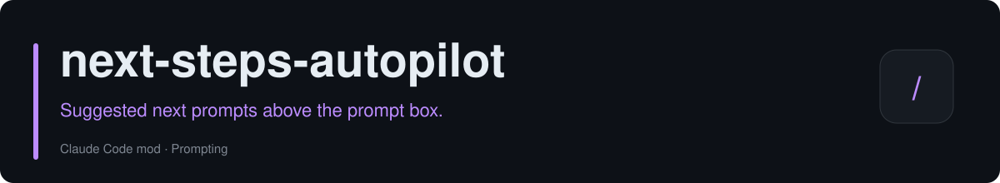

  

## What it does

After most replies, a "What next?" button appears above the prompt box. Press it and Claude Code shows up to three prompts you might type next. You pick one, check it and press Enter. Nothing is sent for you unless you turn on `/auto`.

- After a reply of 80 characters or more (configurable), "What next?" appears. Press `1` (with an empty prompt box) or click it.
- Press `1`, `2` or `3` (with an empty prompt box) to put that suggestion in the box. Edit it, then press Enter. `0` dismisses the suggestions. Tab takes the greyed-out first suggestion.

### Auto mode

Off at the start of every session.

- `/auto` or `/auto on`: after each reply, suggestions are asked for at once and suggestion 1 is sent after the countdown (10 seconds unless you changed the "Auto mode countdown" option).
- `/auto 5`: turn it on with a 5 second countdown for this session. Any whole number up to 999 works.
- `/auto 0` or `/auto instant`: send at once, no countdown. The next plain `/auto` goes back to a countdown.
- `/auto off`: stop.
- Press `0` or start typing to stop a countdown. A prompt you send yourself resets the run.
- It stops after 10 sends in a row until you send something yourself.
- A suggestion that mentions merge, push, delete, deploy, force, reset, drop, rm, publish or release is never sent by itself; it stays on screen for you to press.

## What it needs

Install: `claude plugin install next-steps-autopilot@moka-harness`.

Claude Code 2.1.287 or newer. Tested on macOS in the terminal; other systems, the desktop app and code editor plug-ins are untested. No outside tool, key or binary.

Options (set through the plugin's configuration): `minAnswerChars`, `suggestSkills`, `autoSeconds`.

## Hook events it uses

`session.start`, `command.run` (`/auto`), `session.end`, `prompt.edit`, `prompt.submit`, `turn.start`, `turn.complete`, `ui.render`.

## What it deletes or stops

Nothing is deleted. In auto mode it holds a suggestion that matches the risky-word list above, and it pauses after 10 automatic sends in a row.

## What it sends off the machine

No network access of its own and no files read or written; state lives in memory only. Each press of "What next?" (or each reply while `/auto` is on) makes one short extra request to the model your session already uses, reusing the conversation Claude has. The request lists your skills and your commands that start with `/` so a suggestion can be one of them; switch that off with the "Suggest skills and slash commands" option.

## Known limits

- Suggestions are the model's guess and are sometimes wrong or empty.
- Not every Claude Code screen shows the suggestions; only the terminal was tested.

## License

MIT. Built on [next-steps](https://github.com/anthropics/claude-plugins-community) by Thariq Shihipar, from the Claude Code community plugins; his copyright is kept in LICENSE.
