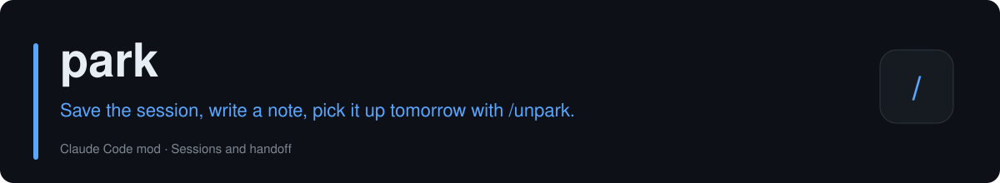

  

## What it does

`/park` saves your work in the current Claude Code tab and writes a short note for your next session. `/unpark` reads that note and picks up where you stopped.

- `/park` saves this tab and writes the next-session note. The note has ten headings: Goal, Done, Open, First step, Decisions and why, Ruled out, Files read and edited, Skills and tools used, Sources and links, Verify command.
- When the note is done, a `## Facts (from code, not from the model)` block is added: the files edited this session, the `git status --short` lines (left out outside a git repo) and your last five prompts word for word.
- You are then asked "Note saved. Continue in a fresh chat?". "Clear and continue" runs `/clear` and the new chat starts with "Read .park/<note> and follow it." "Stay here", Escape, or any error leaves your chat as it was.
- `/unpark` reads the newest note and follows it. At session start, a short message tells you if a note from the last 3 days exists.
- With herdr (see below), `/park` also asks every other idle agent tab to save first, and `/park close` closes the tabs that saved.

Notes go to the `.park/` folder of the project, as `.park/park-<topic>.md`. You may want to add `.park/` to your `.gitignore`.

## What it needs

Claude Code 2.1.287 or newer. macOS or Linux for the full feature set: finding notes uses `find`, so on Windows `/unpark` and the session-start message will not find your notes. `git` is used once per `/park`; it is skipped if it fails.

[herdr](https://herdr.dev) is optional. Both commands work without it. Only inside a herdr session (when `HERDR_SESSION` and `HERDR_PANE_ID` are set) does the plugin run the `herdr` binary. Without it, `/park` saves only this tab and `/park close` reports "Nothing parked" and does nothing.

Install: `claude plugin install park@moka-harness`.

## Hook events it uses

`session.start`, `session.end`, `turn.complete`, `command.run` (`/park`, `/unpark`).

## What it deletes or stops

Nothing is deleted. `/park close`, in herdr only, closes the agent tabs of other terminal sessions that saved successfully. It acts only after you type it, only on tabs that `/park` itself asked to save, and it refuses if any of them did not save or has started working again. It never closes the tab you are in. Without herdr it closes nothing.

## What it sends off the machine

Nothing. No network. It reads the `.park` folder and writes the note and facts block there. The note is written by Claude in the normal session, so it costs one model turn for each tab parked plus one for this tab. The facts block and the fresh-chat step use no model.

## Known limits

- "Saved" means the tab took the save request and went quiet; the plugin does not read the tab to confirm.
- The list of parked tabs is kept in memory. If you reload Claude Code after `/park`, run `/park` again before `/park close`.
- Busy tabs are skipped, not interrupted. They are listed in the note.
- The facts block is read from the session's record. If a part cannot be read, that part is left out.

## License

MIT
